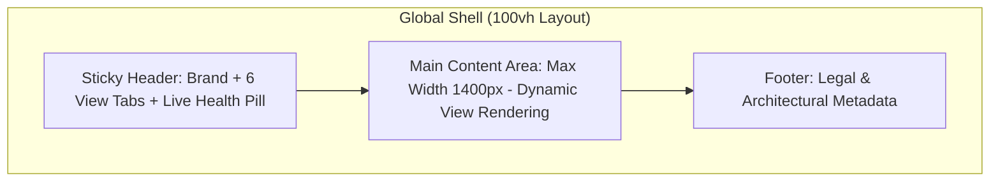

# Synora — Design System & Visual Specification

> **Classification:** UI/UX & Design System Specification  
> **Document Version:** 1.1.0 (Audited & Aligned with Original Proposal)  
> **Design Philosophy:** *Mission-Critical Calm, Institutional Rigor, Enterprise Modernism*

---

## 1. Visual Identity & Brand Philosophy

Synora is designed as an **enterprise intelligence cockpit** for technical teams, engineering directors, and human resource leaders. The aesthetic rejects playful consumer design in favor of:
- **Mission-Critical Calm:** High contrast dark theme inspired by modern developer platforms (Linear, Vercel, Datadog), designed to reduce cognitive load during high-stakes organizational transitions.
- **Data Density with Clarity:** Generous padding around distinct information cards, crisp typographical hierarchy, and scannable visual indicators.
- **Grounded Attribution:** Vibrant accent colors dedicated to operational status, with glowing status pills that provide instant reassurance of system connectivity.
- **Responsible AI UX:** Every AI insight displays inspectable source citation tags, explicit uncertainty notices when ungrounded, and human verification badges.

---

## 2. Color Palette & Design Tokens

All colors are codified as CSS custom properties in `frontend/src/index.css` to guarantee zero runtime overhead and instant theme switching.

### 2.1 Surface & Neutral Tokens
```css
:root {
  /* Surfaces */
  --bg-primary:    #0a0d14; /* Deep void background */
  --bg-secondary:  #101522; /* Elevated navigation & header */
  --bg-card:       #151b2d; /* Primary container card surface */
  --bg-card-hover: #1c233a; /* Card hover elevation */

  /* Borders & Dividers */
  --border-color:  #242c44; /* Subtle structural borders */
  --border-light:  #2e3752; /* Hover & active state borders */

  /* Typography */
  --text-primary:   #f1f5f9; /* High-contrast primary headers & text */
  --text-secondary: #94a3b8; /* Secondary body & descriptions */
  --text-muted:     #64748b; /* Captions, timestamps, metadata labels */
}
```

### 2.2 Semantic Accent Tokens
| Token | HEX Code | Purpose / Usage | Preview |
| :--- | :--- | :--- | :--- |
| `--primary` | `#6366f1` | Brand Indigo: Primary action buttons, active navigation, active state rings |  `#6366f1` |
| `--primary-hover` | `#4f46e5` | Deep Indigo: Hover state on primary interactive elements |  `#4f46e5` |
| `--accent-cyan` | `#06b6d4` | Technical Cyan: Module badges, dependency links, data pipelines |  `#06b6d4` |
| `--accent-emerald` | `#10b981` | Verification Emerald: Healthy status pill, completed handovers, verified facts |  `#10b981` |
| `--accent-amber` | `#f59e0b` | Warning Amber: In-progress handovers, medium risk alerts, pending reviews |  `#f59e0b` |
| `--accent-red` | `#ef4444` | Sentinel Red: Critical single-point-of-failure (SPOF) risks, missing docs |  `#ef4444` |
| `--accent-purple` | `#a855f7` | Radar Purple: Knowledge Loss Radar gaps, coverage metrics |  `#a855f7` |

---

## 3. Typography System

Synora uses a dual-font pairing:
1. **Primary Interface:** `Inter` (Sans-serif) — Clean, legible grotesque typeface optimized for dense dashboards and multi-column tables.
2. **Code & Identifiers:** `JetBrains Mono` (Monospace) — Used for commit hashes, environment variable keys, file paths, IDs, and Docker specs.

### 3.1 Typographic Scale

| Level | Size | Weight | Line Height | Usage |
| :--- | :--- | :--- | :--- | :--- |
| **Hero Title** | 2.0rem (32px) | 800 (Extrabold) | 1.25 | Executive dashboard banner |
| **Section Header** | 1.6rem (25.6px) | 700 (Bold) | 1.3 | Module headers (Handover, Radar, Sentinel) |
| **Card Header** | 1.2rem (19.2px) | 700 (Bold) | 1.35 | Employee names, project titles, modal headings |
| **Body Primary** | 0.95rem (15.2px) | 400 (Regular) | 1.5 | General descriptions, risk analyses |
| **Body Small** | 0.85rem (13.6px) | 500 (Medium) | 1.45 | Checklist items, metadata values, button labels |
| **Caption / Badge** | 0.72rem (11.5px) | 700 (Bold) | 1.2 | Uppercase category tags, severity badges |
| **Code / Identifier** | 0.82rem (13.1px) | 500 (Medium) | 1.5 | IDs (`ho-101`), commands, code snippets |

---

## 4. Layout & Navigation Hierarchy

### 4.1 Shell Layout
The global application layout consists of three vertical sections:
1. **Sticky Header Navbar (`header`):**
   - **Left:** Brand emblem with gradient icon and title "SYNORA" + subtitle "Knowledge Continuity & Project Protection".
   - **Center:** Segmented tab pills (`Overview`, `Handover Engine`, `Loss Radar`, `Synora Sentinel`, `Memory Graph`, `Env Recreator`).
   - **Right:** Real-time backend connectivity status pill with glowing status dot (`online`, `loading`, `offline`).
2. **Main Content Container (`main.main-content`):**
   - Max-width: `1400px`, centered with `padding: 2rem`.
   - Renders the view corresponding to the active navigation tab.
3. **Footer (`footer.footer`):**
   - Enterprise copyright, technology stack credits, and architecture version metadata.



---

## 5. View-Specific Layouts

### 5.1 Overview / Dashboard View
- **Hero Banner:** Deep gradient container (`rgba(30, 41, 59, 0.8)` to `rgba(15, 23, 42, 0.9)`) showcasing the platform thesis and two primary action buttons: *Manage Handover Dossiers* and *Inspect Knowledge Radar*.
- **Executive Metric Cards (4-Column Grid):**
  1. *Active Handovers* (Total dossiers, in-progress count, link to Handover tab).
  2. *Knowledge Coverage* (Project-level documentation coverage score with purple meter).
  3. *Sentinel Risk Alerts* (Total risks, critical SPOF count in warning red).
  4. *Memory Graph Nodes* (Total mapped architecture & module components).
- **Two-Column Split Section:**
  - *Left:* High Priority Sentinel Alerts & Knowledge Gaps quick-feed.
  - *Right:* Recent Handover Dossiers transition queue.

### 5.2 Handover Engine View (Module 6)
- **Header:** View title, subtitle, and primary call-to-action button: *New Handover Dossier* (triggers creation modal).
- **Cards Grid:** Auto-fill grid (`minmax(360px, 1fr)`) containing structured transition cards.
- **Card Anatomy:**
  - *Top Bar:* Department tag, employee name, role, status pill badge.
  - *Metadata Ribbon:* Transition type (Resignation, Retirement, Internal Role Transition, etc.).
  - *Section 1:* Key Responsibilities bulleted list.
  - *Section 2:* Critical Dependencies bulleted list with cyan markers.
  - *Section 3:* Unresolved Knowledge Gaps highlighted in red warning box.
  - *Bottom Bar:* Readiness Assessment progress meter ($0\% - 100\%$) and Markdown export button.
- **Creation Modal:** Frosted glass overlay with structured form inputs (employee, role, department, transition type, multi-line responsibilities, dependencies, blockers).

### 5.3 Knowledge Loss Radar View (Module 5)
- **Header:** Title + purple badge: *Knowledge Loss Radar • Active Gap Detection*.
- **Project Coverage Section:** Visual gauge bars displaying Knowledge Coverage Scores across all monitored repositories.
- **Gaps Grid:** Filterable gap cards categorized by:
  - `ADR_MISSING`: Critical module lacking architectural decision rationale.
  - `SECONDARY_OWNER_MISSING`: Unpaired component with high departure risk.
  - `STALE_DOCUMENTATION`: Documentation unverified in $>90$ days.
- **Card Anatomy:** Module name, detected risk severity badge, gap description, and a *"Resolve Gap / Link Document"* action button.

### 5.4 Synora Sentinel View (Module 7)
- **Header:** Title + green glowing badge: *Sentinel Active • Continuous Protection Enabled*.
- **On-Demand Scan Button:** Triggers real-time repository analysis.
- **Alerts List:** Vertical stack of high-impact risk cards.
- **Risk Card Architecture:**
  - Left border colored by severity (Critical: Red, High: Amber, Medium: Blue).
  - Risk project title, category tag, and uppercase severity badge.
  - Clear narrative description of the detected single point of failure or knowledge concentration.
  - Highlighted "Recommended Action" box with actionable pairing/handover steps.

### 5.5 Organizational Memory Graph & Assistant View (Modules 3 & 4)
- **Toolbar:** Dual-action bar with real-time text search input and category filter dropdown (`All Categories`, `Architecture`, `Module`, `Tooling`, `Process`).
- **Knowledge Node Cards Grid:** Interactive cards displaying category icon, node label, technical description, owner name, confidence score, and verification status badge (`verified` / `unverified`).
- **Interactive AI Assistant Drawer:** Slide-out conversational panel for querying the knowledge base with strict grounding:
  - Answers display clickable source citation tags (`[Source: Doc, Chunk ID]`).
  - Ungrounded questions display an explicit uncertainty banner.

### 5.6 Environment Recreator View (Module 8)
- **Split Layout (1fr to 1.5fr):**
  - *Left (Specs & Checklist):* Architecture breakdown of runtime requirements (FastAPI, React, Uvicorn, Python, Vite) with benefit summaries and interactive onboarding checklist.
  - *Right (Interactive Code Viewer):* Tab switcher between **Docker Compose Spec** and **PowerShell Quickstart**, with a dedicated one-click **Copy Script** button.

---

## 6. Component Style Guide

### 6.1 Buttons
- **Primary Button (`.primary-btn`):** Background `--primary` (`#6366f1`), text `#ffffff`, border radius `10px`, hover elevation `translateY(-1px)` with indigo box-shadow.
- **Secondary Button (`.secondary-btn`):** Background `--bg-card` (`#151b2d`), text `--text-primary`, subtle border `--border-color`.
- **Text Link (`.text-link`):** Borderless, indigo color `#818cf8`, underline on hover.

### 6.2 Status Pills & Badges
- **Status Pill (`.status-pill`):** Compact inline badge with glowing status dot (`online`: green, `loading`: amber, `offline`: red).
- **Verification Badge (`.verify-badge`):** Emerald badge for `verified` facts, amber outline for `unverified / needs review`.
- **Citation Pill (`.citation-pill`):** Cyan badge with external link icon, clicking reveals original source snippet.
