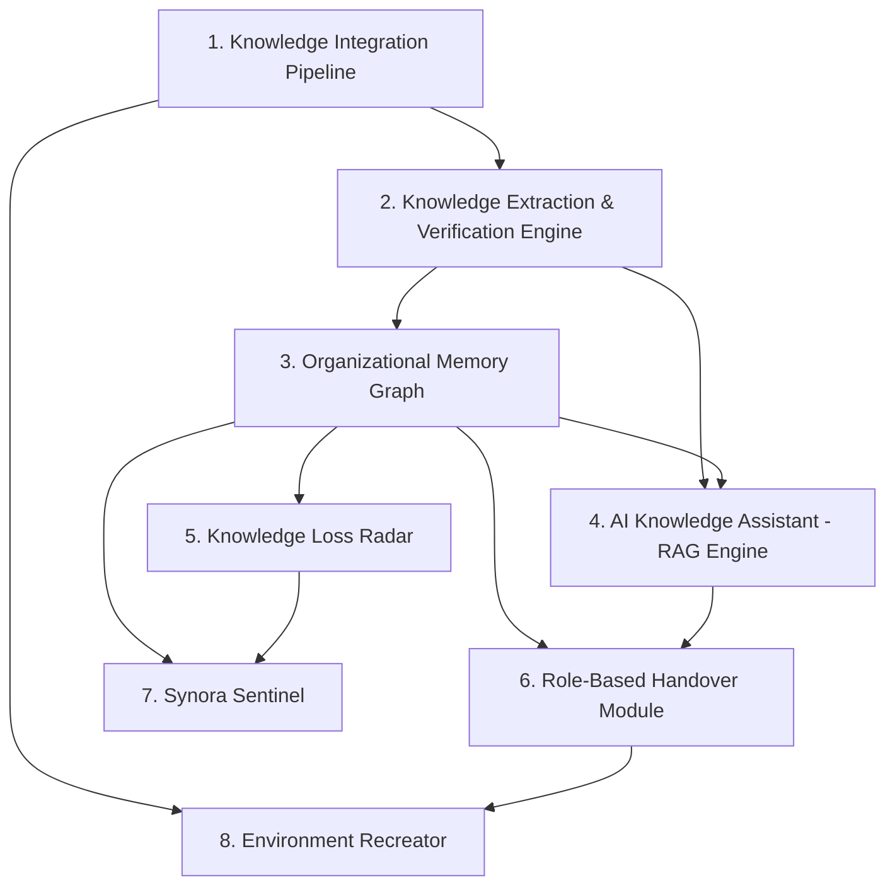
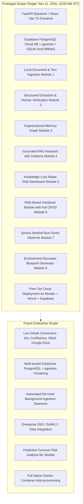

# Synora — Product Requirements Document (PRD)

> **Tagline:** *Where Organizational Knowledge Becomes Lasting Team Intelligence*  
> **Classification:** Confidential / Product Specification  
> **Document Version:** 1.1.0 (Audited & Aligned with Original Proposal)  
> **Status:** Approved for Implementation  
> **Target Delivery Date:** 11 November 2026, 10:00 AM IST (Working Deployed Prototype)

---

## 1. Executive Summary & Problem Definition

### 1.1 The Problem
Modern organizations rely heavily on key technical personnel not only for ongoing delivery but also for maintaining the undocumented institutional context, architectural intent, and historical decisions behind software systems. When key employees leave, transfer, or retire, critical institutional knowledge is lost.

Empirical evidence highlights the severe operational and financial costs of employee turnover:
- **NASA Technical Report on Knowledge Continuity:** Highlighted that the loss of experienced personnel without structured knowledge transfer leads to mission-critical operational hazards and repeated costly mistakes.
- **Boeing Operational Disruption:** Documented in *"Diagnosing the Costs of Lost Knowledge"*, turnover on the 737 and 777 assembly lines caused significant assembly delays and disruptions, leading to substantial financial write-offs.
- **Panopto Workplace Knowledge Survey:** Found that inefficient knowledge sharing costs large enterprises an estimated \$47M annually, with average employees spending 5.3 hours every week searching for or recreating lost documentation.

Existing tools fail to solve this problem systematically:
- **Enterprise Search (Glean, Coveo):** Focuses on surface-level search across SaaS platforms, with zero workflow for structured handover or dependency capture during employee departure.
- **Project Tools (Jira, Confluence, Atlassian Rovo):** Document project tasks and team collaboration, but lack dedicated role-transition workflows or risk detection for orphaned components.
- **Knowledge Bases (Guru, Notion AI):** Function as centralized repositories but do not proactively identify single points of failure, unassigned modules, or reconstruct lost developer environments.

### 1.2 The Solution
**Synora** is an AI-powered Knowledge Continuity and Project Protection Platform that turns scattered organizational knowledge into persistent team intelligence. Synora:
1. Ingests documentation, task tickets, pull requests, and commit records via the **Knowledge Integration Pipeline**.
2. Extracts tacit and explicit knowledge with confidence scoring via the **Knowledge Extraction & Verification Engine**.
3. Builds an **Organizational Memory Graph** that maps relationships between people, projects, decisions, and system dependencies.
4. Delivers context-aware, grounded retrieval with strict source citations via the **AI Knowledge Assistant (RAG Engine)**.
5. Proactively flags missing documentation and critical dependency risks via the **Knowledge Loss Radar**.
6. Generates structured, role-specific transition dossiers with review/approval workflows via the **Role-Based Handover Module**.
7. Monitors project risks and single points of failure (SPOFs) autonomously via **Synora Sentinel**.
8. Enables incoming engineers to reproduce development environments seamlessly via the **Environment Recreator**.

---

## 2. Target Users & Personas

| Persona | Primary Needs & Motivations | Typical Actions in Synora |
| :--- | :--- | :--- |
| **Exiting / Transitioning Employee** | Offload responsibilities rapidly, capture tacit decisions, leave clean legacy documentation without manual burden. | Complete guided handover checklist, verify extracted tasks, record unwritten architectural conventions. |
| **Incoming / New Employee** | Ramp up quickly, understand past decisions, avoid repeating past mistakes, set up development environment without roadblocks. | Read role-specific handover dossier, query AI Knowledge Assistant for historical context, generate local dev environment via Environment Recreator. |
| **Engineering Manager / Tech Lead** | Eliminate single points of failure (SPOFs), assess handover readiness, verify technical handover completeness. | Review handover status, inspect Knowledge Loss Radar & Sentinel alerts, approve and sign off on transition dossiers. |
| **HR & People Operations** | Standardize transition workflows across departments, track employee offboarding timelines, maintain compliance. | Monitor organizational continuity scores, trigger handover workflows upon notice of resignation/role change. |
| **Executive / Organization Admin** | Protect enterprise value, maintain operational resilience, oversee organizational memory assets. | Inspect enterprise knowledge health metrics, configure integration connectors, audit system activity logs. |

---

## 3. Core Use Cases

1. **Employee Resignation:** Autonomous generation of comprehensive exit dossiers documenting ongoing tasks, unmerged code, production credentials, and architectural ownership prior to exit.
2. **Employee Retirement:** Long-term capture of decades of tacit expertise, legacy system nuances, and unrecorded operational procedures.
3. **Internal Role Transition:** Transferring project context and operational responsibilities when an engineer switches teams or steps into leadership.
4. **New Employee Onboarding:** Accelerated onboarding through role-tailored knowledge paths and automated setup scripts.
5. **Project Takeover:** Rapid knowledge transfer when an entire service or codebase is transferred between squads or vendors.
6. **Cross-Team Responsibility Handover:** Resolving ambiguous module ownership and interface boundaries between departments.
7. **Sudden Employee Exit:** Emergency synthesis of scattered Slack discussions, Git commits, and Jira issues to reconstruct missing documentation and broken dependencies.
8. **Organizational Knowledge Search:** Conversational Q&A grounded in verified organizational memory with strict attribution.

---

## 4. The Eight Core Product Modules

Preserving the exact taxonomy and structure of the original Synora specification, the system comprises eight foundational product modules (supported by underlying storage, parsing, and audit infrastructure):

### Module 1: Knowledge Integration Pipeline
- **Purpose:** Ingest, parse, and normalize structured and unstructured data from project repositories and team tools into verified knowledge records.
- **Prototype Functionality:**
  - Local document ingestion supporting Markdown (`.md`), plain text (`.txt`), PDF (`.pdf`), and JSON (`.json`) payloads up to 10MB.
  - Ingestion of simulated Git commit records, pull request histories, and ticket metadata.
  - Sliding-window text chunker (500 tokens with 50-token overlap) preserving source metadata (filename, author, timestamp, chunk index).
  - Source tracking mechanism linking every ingested chunk to an immutable origin identifier.
- **Future Scope:** Live bidirectional OAuth connectors for Google Drive, Notion, Slack, Jira, GitHub, and Confluence.
- **Acceptance Criteria:**
  - Ingestion endpoint accepts files and simulated payloads, returns structured chunk IDs within $< 500\text{ ms}$.
  - Every chunk retains source attribution tags accessible to downstream engines.

### Module 2: Knowledge Extraction & Verification Engine
- **Purpose:** Parse raw document streams into structured organizational entities (Tasks, Architectural Decisions, Dependencies, Credentials, Blockers) with confidence scoring and human verification.
- **Prototype Functionality:**
  - Schema-guided extraction of key entities: Decision Records (`what`, `why`, `alternatives_considered`), Responsibilities (`owner`, `scope`), Dependencies (`module_a`, `module_b`, `criticality`), and Active Blockers.
  - Confidence scoring ($0.0$ to $1.0$) on all extracted items.
  - Uncertainty detection: flags conflicting statements, low confidence ($< 0.65$), or ungrounded claims.
  - Human-in-the-loop verification interface allowing Tech Leads and Managers to review, edit, and approve extracted items before committing them to the verified memory graph.
- **Acceptance Criteria:**
  - Extracted records initially have status `unverified`.
  - Review actions transition records to `verified` with an entry written to `audit_logs`.
  - Confidence score below 0.65 triggers an explicit `NEEDS_REVIEW` badge in the UI.

### Module 3: Organizational Memory Graph
- **Purpose:** Connect disparate organizational entities into an actionable, relational knowledge network mapping employees, projects, decisions, and dependencies.
- **Prototype Functionality:**
  - Core entity nodes: `Employee`, `Project`, `Module`, `Decision`, `Dependency`, `Credential/Tooling`.
  - Directed edge relations: `OWNS`, `MAINTAINS`, `DEPENDS_ON`, `INTERACTS_WITH`, `DECIDED_BY`, `DOCUMENTED_IN`.
  - Graph traversal query service to inspect upstream and downstream impacts of employee departure.
  - Interactive visual graph view in the frontend displaying node clusters, ownership rings, and dependency chains.
- **Acceptance Criteria:**
  - API provides `/api/v1/knowledge/graph` returning structured nodes and edges.
  - Selecting an employee node highlights all connected modules, decisions, and outgoing dependencies.

### Module 4: AI Knowledge Assistant (RAG Engine)
- **Purpose:** Conversational Q&A interface allowing any team member to query organizational memory with strict attribution and confidence bounds.
- **Prototype Functionality:**
  - Provider-independent LLM adapter interface configured via environment variables (`LLM_PROVIDER`, `GEMINI_API_KEY`, `GEMINI_MODEL`, etc.).
  - Vector similarity search against embedded document chunks (cosine similarity threshold $\ge 0.65$).
  - Strict grounding prompt: AI answers solely using retrieved context chunks and memory graph entities.
  - Clickable source citations attached to every generated statement (document name, section, author, timestamp).
  - Explicit uncertainty handling: when retrieved context similarity is below threshold or documentation is absent, the assistant explicitly replies: *"No verified institutional documentation exists for this query."*
- **Acceptance Criteria:**
  - 100% of generated responses display inspectable citation pills linking to verified source chunks.
  - Absolute claims of zero hallucination are prohibited; confidence bounds and uncertainty declarations are strictly enforced.
  - Query latency is $< 2.5\text{ s}$ for end-to-end retrieval and response.

### Module 5: Knowledge Loss Radar
- **Purpose:** Dedicated proactive risk dashboard that detects missing organizational documentation, unrecorded decisions, and critical dependency vulnerabilities across squads and systems.
- **Prototype Functionality:**
  - Scans project modules and knowledge nodes to identify knowledge gaps:
    - Modules without linked architectural decision records (`ADR_MISSING`).
    - Critical services lacking an assigned secondary maintainer (`SECONDARY_OWNER_MISSING`).
    - Outdated documentation where the underlying codebase has evolved without doc updates (`STALE_KNOWLEDGE`).
  - Calculates a **Knowledge Coverage Score** ($0\%$ to $100\%$) for each project.
  - Generates actionable gap remediation tasks (e.g. *"Schedule architecture interview for Auth Service before Sprint 42"*).
- **Acceptance Criteria:**
  - Radar dashboard lists all detected knowledge gaps sorted by risk severity (`Critical`, `High`, `Medium`).
  - Resolving a gap or linking a verified document immediately updates the project's Knowledge Coverage Score.

### Module 6: Role-Based Handover Module
- **Purpose:** Autonomous compilation, guided review, and formal sign-off of tailored transition dossiers for departing or transitioning employees.
- **Prototype Functionality:**
  - Role-specific transition templates (Backend Engineer, Frontend Lead, SRE, Engineering Manager).
  - Structured dossier sections: Core Responsibilities, Critical External Dependencies, Active PRs/Tickets, Unresolved Knowledge Gaps, Access Credentials Held.
  - Handover lifecycle progression: `draft` $\rightarrow$ `in_progress` $\rightarrow$ `verified` $\rightarrow$ `completed`.
  - **Handover Readiness Assessment Score** ($0\%$ to $100\%$):
    $$\text{Readiness Score} = \frac{\text{Verified & Approved Items}}{\text{Total Identified Items}} \times 100\%$$
  - Multi-format export: Clean Markdown export (`.md`) and printable HTML/PDF view.
- **Acceptance Criteria:**
  - Users can create, view, update, verify, and export handover dossiers.
  - Transition to `completed` requires all critical blockers to be marked as resolved and approved by a `Manager` or `Admin`.

### Module 7: Synora Sentinel
- **Purpose:** Automated, continuous project activity observer that calculates team continuity metrics, tracks commit/code concentration, and raises immediate Single Point of Failure (SPOF) alerts.
- **Prototype Functionality:**
  - **Bus Factor Analysis:** Computes knowledge concentration per repository/module:
    $$\text{Bus Factor} = \min \left\{ |S| : S \subset \text{Authors}, \, \sum_{a \in S} \text{Ownership}(a) \ge 0.5 \right\}$$
    Automatically flags components where a single engineer holds $>75\%$ of contributions.
  - **SPOF Risk Alert Generation:** Creates actionable risk cards with severity ratings (`Critical`, `High`, `Medium`).
  - **Mitigation Recommendations:** Provides concrete mitigation steps (e.g. *"Assign paired code review with Senior Engineer B"*, *"Initiate Handover Dossier"*).
  - Live on-demand and background scan triggers.
- **Acceptance Criteria:**
  - Triggering `/api/v1/sentinel/scan` scans project metrics, identifies Bus Factor $= 1$, and produces `RiskAlert` records.
  - Sentinel cards display severity, affected project, metric evidence, and recommended mitigation.

### Module 8: Environment Recreator
- **Purpose:** Eliminate incoming engineer onboarding downtime by inspecting repository configurations and generating deterministic, reproducible local and containerized development environments.
- **Prototype Functionality:**
  - Manifest inspection parser supporting `package.json`, `requirements.txt`, `pyproject.toml`, `Dockerfile`, `docker-compose.yml`, and `.env.example`.
  - Deterministic run configuration generator:
    - Windows PowerShell launch sequence (`.cmd` aware, virtual environment activation).
    - Bash launch sequence for macOS / Linux.
    - Self-contained `docker-compose.yml` with health check probes.
  - Interactive onboarding checklist for incoming developers to verify tool installation and connectivity step-by-step.
- **Acceptance Criteria:**
  - Recreator endpoint returns runnable command sequences for the detected stack.
  - Frontend provides a one-click "Copy Script" button and downloadable configuration files.

---

## 5. Architectural Infrastructure Layer (Not Product Modules)

The eight product modules are built on top of a shared, reliable technical infrastructure:
- **Persistence & Vector Storage:** Managed **Supabase PostgreSQL** cloud instance with the `pgvector` extension for embeddings and full ACID relational tables for entities and audit logs. (SQLite is supported strictly as a zero-setup local development fallback).
- **Document Processing Engine:** Centralized file parsing, text chunking, and MIME validation library used by the Knowledge Integration Pipeline.
- **Immutable Audit Trail:** An append-only `audit_logs` table recording all AI extractions, confidence scores, human reviews, role modifications, and handover sign-offs.

---

## 6. User Stories & Acceptance Criteria

### User Story 1: Handover Creation & Verification
- **As an** Engineering Manager,
- **I want to** generate a structured handover dossier for a departing Senior Backend Engineer,
- **So that** their architectural decisions, service dependencies, and ongoing blockers are preserved and verified before their last working day.
- **Acceptance Criteria:**
  - System captures employee name, role, department, transition type, responsibilities, dependencies, and blockers.
  - Handover dossier transitions across clear states: `draft` $\rightarrow$ `in_progress` $\rightarrow$ `verified` $\rightarrow$ `completed`.
  - Missing or unverified critical dependencies trigger an explicit blocker alert.

### User Story 2: Continuity Risk Detection (Sentinel)
- **As a** Tech Lead,
- **I want** Synora Sentinel to alert me when a single engineer is the sole maintainer of a critical production component,
- **So that** we can mitigate single points of failure before unforeseen departures occur.
- **Acceptance Criteria:**
  - Sentinel displays risk level (`critical`, `high`, `medium`, `low`), project name, risk category, description, and recommended action.
  - Risk cards clearly differentiate single points of failure from undocumented workflows.

### User Story 3: Proactive Knowledge Gap Detection (Knowledge Loss Radar)
- **As a** VP of Engineering,
- **I want** the Knowledge Loss Radar to highlight critical systems lacking architectural documentation or secondary owners,
- **So that** our organization eliminates hidden operational risks before key personnel leave.
- **Acceptance Criteria:**
  - Radar calculates project-level Knowledge Coverage Scores.
  - System flags unowned modules and missing ADRs with recommended documentation tasks.

### User Story 4: Context-Aware Knowledge Retrieval
- **As an** Incoming Developer,
- **I want to** ask natural-language questions about how the distributed payment failover works,
- **So that** I understand the architectural rationale without interrupting senior engineers.
- **Acceptance Criteria:**
  - AI Assistant returns responses grounded exclusively in verified knowledge nodes.
  - Every assertion links to an inspectable source citation.
  - Queries with insufficient documentation respond with an explicit uncertainty flag.

### User Story 5: Development Environment Reproduction
- **As an** Incoming Developer,
- **I want to** access an auto-generated development configuration spec,
- **So that** I can spin up the application services in minutes.
- **Acceptance Criteria:**
  - Recreator generates both Docker Compose and Local PowerShell run scripts.
  - Environment variables, ports, and runtime versions are accurately specified.

---

## 7. Non-Functional Requirements (NFRs)

| ID | Category | Requirement Description | Target Metric |
| :--- | :--- | :--- | :--- |
| **NFR-1** | **Performance** | API endpoint latency for standard CRUD operations | $< 150\text{ ms}$ (95th percentile) |
| **NFR-2** | **Performance** | RAG query response time (retrieval + synthesis) | $< 2.5\text{ s}$ |
| **NFR-3** | **Security** | Secrets and sensitive environment variables must never be exposed via API or client bundles | Zero leakage in build or responses |
| **NFR-4** | **Data Integrity** | All handover modifications and risk acknowledgments must produce audit records | 100% audit logging |
| **NFR-5** | **Deployability** | Prototype must operate fully within free-tier cloud limits (Render, Vercel, Supabase PostgreSQL) | Zero initial cloud infrastructure cost |
| **NFR-6** | **Reliability** | Client frontend must gracefully handle backend downtime and display descriptive offline status | Visual status pill + retry logic |

---

## 8. Prototype Scope vs. Future Scope

To ensure delivery of a **working deployed prototype by 11 November 2026, 10:00 AM IST**, the project scope is divided as follows:

---

## 9. Prototype Acceptance Criteria

A successful prototype delivery requires:
1. **Frontend:** React + Vite + TypeScript application running cleanly without compilation errors, responsive across desktop and tablet viewports, dark-mode enterprise UI.
2. **Backend:** FastAPI application running on Python 3.12, fully documented with OpenAPI/Swagger at `/api/v1/docs`.
3. **Database:** Persistent cloud Supabase PostgreSQL database configured with SQLAlchemy models and automated seeding for immediate demo viability (with SQLite local fallback).
4. **All Eight Core Modules Functional:**
   - **Knowledge Integration Pipeline:** File and document upload, parsing, and chunking with source tracking.
   - **Knowledge Extraction & Verification Engine:** Extraction of decisions/dependencies with confidence scoring and human approval.
   - **Organizational Memory Graph:** Entity node and relation viewing with graph traversal.
   - **AI Knowledge Assistant:** Grounded RAG with clickable source citations and uncertainty declaration.
   - **Knowledge Loss Radar:** Risk dashboard detecting undocumented systems, missing ADRs, and coverage scores.
   - **Role-Based Handover Module:** Create, list, inspect, verify, and export transition dossiers.
   - **Synora Sentinel:** Continuous bus factor calculation and SPOF alerts with mitigation guidance.
   - **Environment Recreator:** Copyable Docker and local quickstarts with onboarding checklists.
5. **Testing:** Automated test suite (`pytest` for backend, `tsc -b && vite build` for frontend) with 100% passing status.
6. **Live Deployment:** Publicly accessible on free-tier hosting (Render for backend, Vercel for frontend, Supabase for PostgreSQL) before **11 November 2026, 10:00 AM IST**.
