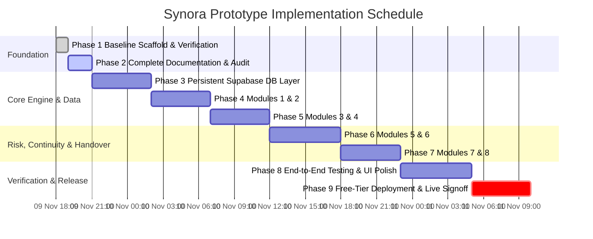

# Synora — Sequential Implementation Roadmap & Delivery Plan

> **Classification:** Project Delivery Roadmap  
> **Document Version:** 1.1.0 (Audited & Aligned with Original Proposal)  
> **Hard Deadline:** **11 November 2026, 10:00 AM IST** (Working Deployed Prototype)  
> **Current Reference Time:** 09 November 2026, 21:10 IST  
> **Total Runway:** ~37 Hours

---

## 1. Roadmap Overview & Timeline

The implementation plan is structured into sequential phases engineered to deliver a feature-complete, thoroughly tested, and publicly deployed prototype prior to the November 11 deadline.

---

## 2. Phase Breakdown

---

### Phase 1: Project Foundation & Baseline Setup
- **Status:** **COMPLETED** (09 Nov 2026, 18:45 IST)
- **Objectives:** Initialize the repository, verify system prerequisites (Node.js v26.13.0, Python 3.12.6), establish the FastAPI backend and React + Vite + TypeScript frontend, and verify live server execution.
- **Key Tasks Completed:**
  - Scaffolded React + Vite + TypeScript frontend; configured `npm.cmd` package management and Lucide icons.
  - Created Python virtual environment (`.venv`) with FastAPI, Uvicorn, Pydantic, HTTPX, and Pytest.
  - Implemented baseline API routers (`/health`, `/handovers`, `/sentinel/risks`, `/knowledge/nodes`).
  - Verified local server probing on both ports 8000 and 5173.
  - Wrote root `README.md` and `.gitignore`.
- **Dependencies:** Workspace initialization.
- **Expected Files:** `backend/`, `frontend/`, `README.md`, `.gitignore`.
- **Testable Deliverables & Acceptance Criteria:** `pytest` passes 5/5 tests; `npm.cmd run build` passes with zero errors; both services respond with HTTP 200.

---

### Phase 2: Complete Project Documentation & Consistency Audit
- **Status:** **COMPLETED / AUDITED** (09 Nov 2026, 21:10 IST)
- **Objectives:** Establish comprehensive, authoritative project documentation inside `/docs` preserving the original Synora proposal's 8 core modules, target users, use cases, and technical requirements. Correct draft inconsistencies.
- **Key Tasks:**
  - Author and audit `docs/PRD.md` (Product Requirements Document).
  - Author and audit `docs/Architecture.md` (System Architecture & Technical Specification).
  - Author and audit `docs/Rules.md` (Development Rules & Engineering Standards).
  - Author and audit `docs/Phases.md` (Sequential Implementation Roadmap - this document).
  - Author and audit `docs/Design.md` (Visual Identity & UI Design System).
  - Author and audit `docs/Memory.md` (Living Project State & Decision Log).
- **Dependencies:** Original project proposal extracted from `synora.pdf`.
- **Expected Files:**
  - `docs/PRD.md`
  - `docs/Architecture.md`
  - `docs/Rules.md`
  - `docs/Phases.md`
  - `docs/Design.md`
  - `docs/Memory.md`
- **Testable Deliverables & Acceptance Criteria:** All six documents created, internally consistent, preserving the exact eight product modules, specifying Supabase PostgreSQL with SQLite local fallback, removing absolute claims, and establishing clear prototype-level acceptance criteria.

---

### Phase 3: Persistent Database Layer & Schema Migrations
- **Window:** 09 Nov 2026, 21:15 IST – 10 Nov 2026, 02:00 IST (~4.75 Hours)
- **Objectives:** Implement a persistent database layer configured for cloud **Supabase PostgreSQL** via `DATABASE_URL` with an automated **SQLite local development fallback**. Establish SQLAlchemy models for all 8 modules and create an automated seeder.
- **Key Tasks:**
  - Implement `backend/app/core/database.py` with SQLAlchemy dialect abstraction (PostgreSQL pool settings + SQLite fallback).
  - Create database entity models:
    - `backend/app/models/handover.py` (`HandoverModel` for Module 6)
    - `backend/app/models/risk.py` (`RiskAlertModel` for Module 7)
    - `backend/app/models/radar.py` (`KnowledgeGapModel`, `ProjectCoverageModel` for Module 5)
    - `backend/app/models/knowledge.py` (`KnowledgeNodeModel`, `KnowledgeEdgeModel` for Module 3)
    - `backend/app/models/document.py` (`DocumentModel`, `DocumentChunkModel` for Modules 1 & 4)
    - `backend/app/models/audit.py` (`AuditLogModel` for compliance)
  - Build automated database seeding script `backend/app/core/seed.py` with realistic enterprise seed records (distributed payments handover, Kafka CDC SPOF alert, missing ADR gaps).
  - Refactor existing endpoints to query the database via FastAPI `Depends(get_db)`.
  - Expand Pytest test suite to verify database persistence across restarts.
- **Dependencies:** Phase 2 Documentation approved.
- **Expected Files:**
  - `backend/app/core/database.py`
  - `backend/app/core/seed.py`
  - `backend/app/models/*.py`
  - `backend/tests/test_database.py`
- **Testable Deliverables & Acceptance Criteria:** Database tables initialize automatically on startup; seed records are populated on first run; all CRUD operations persist across process restarts; 100% test pass rate in `pytest`.

---

### Phase 4: Modules 1 & 2 — Knowledge Integration & Extraction Engine
- **Window:** 10 Nov 2026, 02:00 IST – 10 Nov 2026, 07:00 IST (~5 Hours)
- **Objectives:** Implement **Module 1 (Knowledge Integration Pipeline)** and **Module 2 (Knowledge Extraction & Verification Engine)**.
- **Key Tasks:**
  - Create `backend/app/services/ingestion.py`:
    - Document parsers for `.md`, `.txt`, `.json`, and `.pdf` files.
    - Sliding-window text chunker (500 tokens with 50-token overlap).
    - Metadata extraction (title, author, timestamp, tags) and source tracking hash.
  - Create `backend/app/services/extraction.py`:
    - Provider-independent LLM extraction interface (`backend/app/core/llm.py`).
    - Structured extraction of technical decisions, dependencies, and blockers with confidence scores ($0.0 - 1.0$).
    - Uncertainty detector (flags items with confidence $< 0.65$ or ungrounded claims).
  - Add API endpoints in `backend/app/api/v1/endpoints/documents.py`:
    - `POST /api/v1/documents/upload` (multipart file upload).
    - `GET /api/v1/documents/` (list ingested documents).
    - `POST /api/v1/documents/{id}/extract` (trigger extraction pipeline).
    - `PATCH /api/v1/knowledge/nodes/{id}/verify` (human verification sign-off).
  - Build document upload and extraction UI in `frontend/src/components/DocumentUploadModal.tsx`.
- **Dependencies:** Phase 3 Database Models.
- **Expected Files:**
  - `backend/app/core/llm.py`
  - `backend/app/services/ingestion.py`
  - `backend/app/services/extraction.py`
  - `backend/app/api/v1/endpoints/documents.py`
  - `frontend/src/components/DocumentUploadModal.tsx`
  - `backend/tests/test_ingestion.py`
- **Testable Deliverables & Acceptance Criteria:** Uploading a document parses text into chunks; extraction generates structured entities with confidence scores; human verification updates entity status to `verified` and writes to `audit_logs`.

---

### Phase 5: Modules 3 & 4 — Organizational Memory Graph & AI Assistant (RAG)
- **Window:** 10 Nov 2026, 07:00 IST – 10 Nov 2026, 12:00 IST (~5 Hours)
- **Objectives:** Implement **Module 3 (Organizational Memory Graph)** and **Module 4 (AI Knowledge Assistant with strict source citations)**.
- **Key Tasks:**
  - Create `backend/app/services/rag.py`:
    - Vector similarity indexing (pgvector / lightweight cosine similarity).
    - Top-k chunk retrieval with similarity threshold filtering ($\ge 0.65$).
    - Grounded prompt synthesizer enforcing citation tags `[Source: DocName, ChunkID]`.
    - Explicit uncertainty response when documentation is absent or similarity is below threshold.
  - Create `backend/app/services/graph.py`:
    - Node creation, edge linkage (`OWNS`, `DEPENDS_ON`, `MAINTAINS`), and dependency traversal queries.
  - Implement API endpoints:
    - `POST /api/v1/knowledge/query` (RAG Q&A with citations).
    - `GET /api/v1/knowledge/graph` (return nodes and edges for visualization).
  - Enhance `frontend/src/components/KnowledgeView.tsx`:
    - Add an interactive "Ask Synora AI" conversational panel.
    - Render clickable source citation pills that display originating text snippets.
    - Visual node-edge graph canvas using interactive card clusters and SVG links.
- **Dependencies:** Phase 4 Ingested Chunks & Extraction Engine.
- **Expected Files:**
  - `backend/app/services/rag.py`
  - `backend/app/services/graph.py`
  - `frontend/src/components/AskSynoraModal.tsx`
  - `frontend/src/components/KnowledgeGraphCanvas.tsx`
  - `backend/tests/test_rag.py`
- **Testable Deliverables & Acceptance Criteria:** Asking questions returns grounded answers with explicit citations; ungrounded questions return an explicit uncertainty warning; graph explorer displays relationships between services and owners.

---

### Phase 6: Modules 5 & 6 — Knowledge Loss Radar & Role-Based Handover
- **Window:** 10 Nov 2026, 12:00 IST – 10 Nov 2026, 18:00 IST (~6 Hours)
- **Objectives:** Implement **Module 5 (Knowledge Loss Radar)** and **Module 6 (Role-Based Handover Module)** with full status workflows and multi-format exports.
- **Key Tasks:**
  - Implement `backend/app/services/radar.py`:
    - Project knowledge scanner: detects missing ADRs, unassigned secondary owners, and stale documentation.
    - Knowledge Coverage Score calculation ($0\% - 100\%$).
    - `GET /api/v1/radar/gaps` and `GET /api/v1/radar/coverage`.
  - Implement `backend/app/services/handover.py`:
    - Full lifecycle transitions: `draft` $\rightarrow$ `in_progress` $\rightarrow$ `verified` $\rightarrow$ `completed`.
    - Dynamic Handover Readiness Assessment Score calculation:
      $$\text{Readiness Score} = \frac{\text{Verified Items}}{\text{Total Items}} \times 100\%$$
    - Blocker resolution checklist and manager approval sign-off.
    - Multi-format export: Clean Markdown export (`.md`) and printable HTML view.
  - Create `frontend/src/components/RadarView.tsx` with risk cards and coverage meters.
  - Update `frontend/src/components/HandoverView.tsx` with inline editing, status progression controls, and readiness score meter.
- **Dependencies:** Phase 3 Database & Phase 5 Knowledge Graph.
- **Expected Files:**
  - `backend/app/services/radar.py`
  - `backend/app/services/handover.py`
  - `backend/app/api/v1/endpoints/radar.py`
  - `frontend/src/components/RadarView.tsx`
  - `frontend/src/components/HandoverDetailModal.tsx`
  - `backend/tests/test_radar_and_handover.py`
- **Testable Deliverables & Acceptance Criteria:** Radar flags knowledge gaps and displays coverage scores; users can create, edit, verify, and complete transition dossiers; readiness score updates reactively; dossiers export cleanly to Markdown.

---

### Phase 7: Modules 7 & 8 — Synora Sentinel & Environment Recreator
- **Window:** 10 Nov 2026, 18:00 IST – 10 Nov 2026, 23:00 IST (~5 Hours)
- **Objectives:** Implement **Module 7 (Synora Sentinel Observer)** and **Module 8 (Environment Recreator)**.
- **Key Tasks:**
  - Implement `backend/app/services/sentinel.py`:
    - Automated repository/code metrics scanner.
    - Bus factor calculator: flags projects where 1 developer accounts for $>80\%$ of activity.
    - Risk generator: auto-creates `RiskAlert` records with severity levels and mitigation advice.
  - Implement `backend/app/services/recreator.py`:
    - Manifest scanner detecting Python, Node.js, and Docker configurations.
    - Generates OS-specific setup scripts (PowerShell, Bash) and `docker-compose.yml` blueprints.
    - Generates interactive onboarding checklist.
  - Implement API endpoints:
    - `POST /api/v1/sentinel/scan` (trigger project continuity scan).
    - `GET /api/v1/recreator/generate` (dynamic config generator).
  - Update `frontend/src/components/SentinelView.tsx` with a live "Run Sentinel Scan" button.
  - Update `frontend/src/components/RecreatorView.tsx` with dynamic stack selector and download script button.
- **Dependencies:** Phase 5 Graph & Phase 6 Handover Engine.
- **Expected Files:**
  - `backend/app/services/sentinel.py`
  - `backend/app/services/recreator.py`
  - `backend/tests/test_sentinel.py`
- **Testable Deliverables & Acceptance Criteria:** Running Sentinel scan dynamically calculates bus factor and flags SPOF components; Environment Recreator outputs accurate setup commands and copyable launch sequences.

---

### Phase 8: End-to-End Testing & UI Polish
- **Window:** 10 Nov 2026, 23:00 IST – 11 Nov 2026, 05:00 IST (~6 Hours)
- **Objectives:** Comprehensive test suite execution, UI/UX polish, accessibility checks, and performance optimization.
- **Key Tasks:**
  - End-to-end integration tests covering the complete workflow across all eight modules:
    *Document Ingest $\rightarrow$ Extract Knowledge $\rightarrow$ Build Graph $\rightarrow$ Radar Gap Detection $\rightarrow$ Generate Handover $\rightarrow$ Sentinel Bus Factor Alert $\rightarrow$ Recreate Dev Env.*
  - Frontend responsiveness testing across Mobile ($<768\text{px}$), Tablet ($768\text{px} - 1199\text{px}$), and Desktop ($\ge 1200\text{px}$).
  - Polish animations, hover states, loading skeletons, and error boundary toasts.
  - Verify zero console errors, zero TypeScript compilation errors, and 100% passing Pytest suite.
- **Dependencies:** All previous phases completed.
- **Expected Files:**
  - `backend/tests/test_e2e_workflow.py`
  - `frontend/src/components/Toast.tsx`
  - `frontend/src/components/ErrorBoundary.tsx`
- **Testable Deliverables & Acceptance Criteria:** 100% test pass rate across backend and frontend; verified keyboard navigation; zero console errors.

---

### Phase 9: Free-Tier Cloud Deployment & Live Signoff
- **Window:** 11 Nov 2026, 05:00 IST – 11 Nov 2026, 10:00 AM IST (~5 Hours)
- **Objectives:** Deploy the complete platform to free-tier cloud hosting (Render for FastAPI backend, Vercel for React frontend, Supabase for persistent PostgreSQL), configure environment variables, and perform live public verification.
- **Key Tasks:**
  - Configure Supabase PostgreSQL database instance; apply schema migrations.
  - Configure `render.yaml` or Render dashboard deployment settings for the Python backend with `DATABASE_URL` pointing to Supabase.
  - Configure `vercel.json` or Vite production build settings for the React frontend.
  - Set production CORS origins and API base URL environment variables (`VITE_API_URL`).
  - Perform live smoke tests on the production URLs:
    - OpenAPI docs at `/api/v1/docs`.
    - Health check endpoint returning HTTP 200.
    - Frontend loads live data, creates a handover, inspects Radar gaps, runs a Sentinel scan, and queries knowledge graph.
  - Final documentation update in `Memory.md` confirming delivery signoff.
- **Dependencies:** Phase 8 Testing.
- **Expected Files:**
  - `render.yaml`
  - `vercel.json`
  - `docs/Memory.md` (updated status)
- **Testable Deliverables & Acceptance Criteria:** Both frontend and backend accessible over public HTTPS URLs; persistent data stored in Supabase PostgreSQL; all 8 modules operational; completed before **11 November 2026, 10:00 AM IST**.

---

## 3. Milestones & Delivery Checklist

| Milestone | Target Timestamp | Status |
| :--- | :--- | :--- |
| **M1: Baseline Architecture & Scaffolding** | 09 Nov 2026, 18:45 IST | **COMPLETED** |
| **M2: Complete Documentation Suite in `/docs` (Audited)** | 09 Nov 2026, 21:10 IST | **COMPLETED** |
| **M3: Persistent Supabase DB Layer Active** | 10 Nov 2026, 02:00 IST | Pending |
| **M4: Ingestion & Extraction Pipeline (Modules 1 & 2)** | 10 Nov 2026, 07:00 IST | Pending |
| **M5: Memory Graph & RAG Assistant (Modules 3 & 4)** | 10 Nov 2026, 12:00 IST | Pending |
| **M6: Radar & Handover Engine (Modules 5 & 6)** | 10 Nov 2026, 18:00 IST | Pending |
| **M7: Sentinel & Environment Recreator (Modules 7 & 8)** | 10 Nov 2026, 23:00 IST | Pending |
| **M8: Complete E2E Test Suite Passing** | 11 Nov 2026, 05:00 IST | Pending |
| **M9: Deployed Public Prototype (Final Signoff)** | **11 Nov 2026, 10:00 AM IST** | **HARD DEADLINE** |
